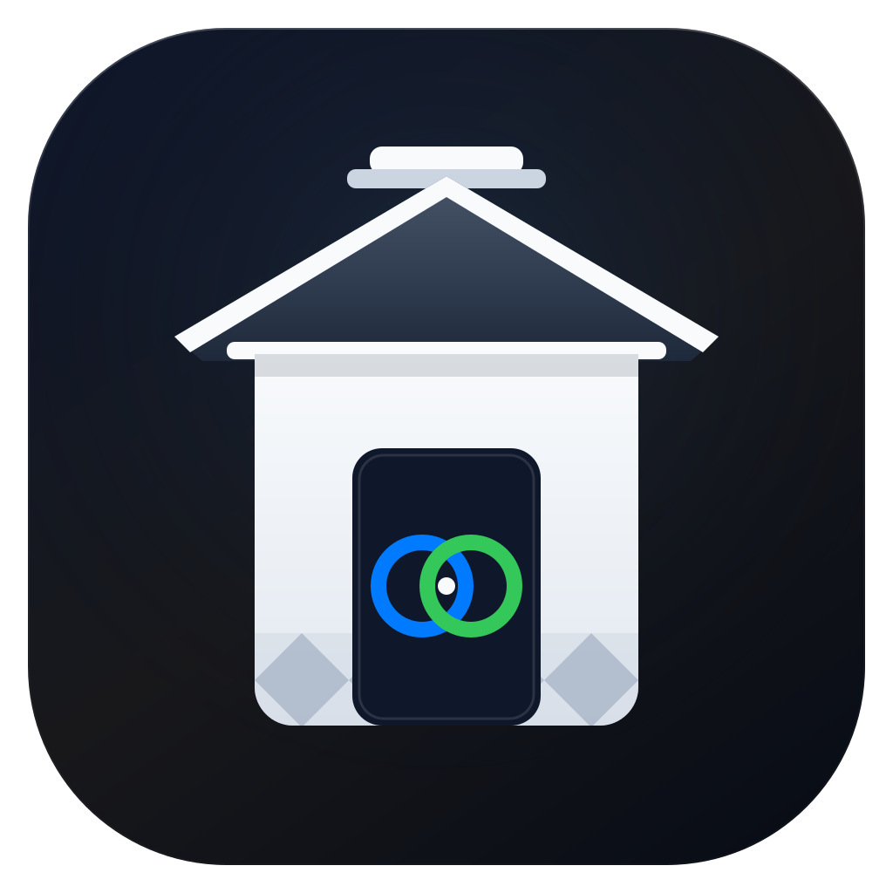
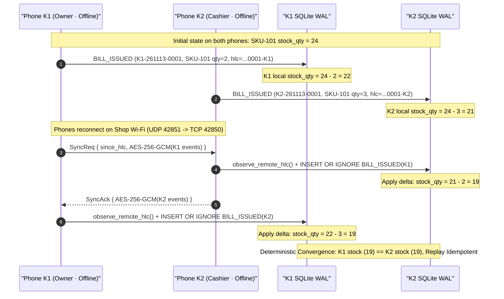

<div align="center">



# Kura (蔵) — Offline Shop Stock, POS & Multi-Phone Bill Sync

**Ultra-lightweight, zero-account, offline-first Point-of-Sale, CRDT Inventory Ledger, Executive Home Dashboard, Full P&L Statement, Supplier Payables, Customer Khata, Cash Drawer Reconciliation & Thermal/PDF Receipt Engine.**

[](https://v2.tauri.app/)
[](https://www.rust-lang.org/)
[](https://preactjs.com/)
[](https://tailwindcss.com/)
[](https://www.sqlite.org/wal.html)
[](#5-mathematical--data-integrity-guarantees)
[](#11-developer-setup-testing--build-instructions)
[](LICENSE)
[](https://thisissufian.github.io/kura-shop-sync/)

</div>

---

## 1. Brand Vision & Engineering Ethos

In traditional Japanese architecture, a **Kura (蔵)** is an earthen-walled merchant storehouse engineered to safeguard a family business's most valuable goods and accounting ledgers from fire, theft, and disaster.

**Kura** applies that exact philosophy to modern neighborhood commerce across Android phones and Windows counters:
- Your inventory counts, bills, profit margins, supplier payables, and customer due ledgers live inside a fast, ACID-compliant **SQLite WAL** vault on your own devices.
- All business logic, CRDT merging, cryptography, LAN networking, ESC/POS encoding, and vector PDF rendering execute in native **Rust**.
- The user interface is an Apple Cupertino HIG **Preact + Signals + Tailwind CSS v4** layer (supporting both **Cupertino Light** and **True OLED Dark Mode** plus mobile safe-area insets) delivering the entire production frontend in **`54.72 KB` gzipped** (`0.44 KB` HTML + `8.02 KB` CSS + `46.26 KB` JS), strictly enforcing a **220-line per-file ceiling** across every `.rs`, `.ts`, and `.tsx` source file.
- Experience the live interactive web demo and product showcase at **[https://thisissufian.github.io/kura-shop-sync/](https://thisissufian.github.io/kura-shop-sync/)**.

---

## 2. Executive Summary: Why Kura Exists

| Capability | Typical Cloud SaaS POS | **Kura (蔵)** |
| :--- | :--- | :--- |
| **Account / Login Required** | Mandatory email, OTP & cloud workspace | **Zero accounts** — instant offline launch |
| **Monthly / Per-Register Cost** | \$15–\$79/month per terminal | **\$0 forever** — zero developer servers |
| **Offline Checkout & Stock** | Breaks or causes lost stock overwrites | **Deterministic CRDT HLC ledger** merges offline edits safely |
| **Executive Intelligence** | Basic cloud reports or add-on cost | **Executive Home Dashboard, Full P&L Statement & 7-Day Trend** |
| **Vendor Payables** | Separate accounting app required | **Native Supplier Payables ("Vendor Dues") & Stock Restock Ledger** |
| **Multi-Phone Counter Sync** | Requires round-trip cloud servers | **Brave-style QR Sync Chain** over local Wi-Fi + optional E2EE relay |
| **Cashier Permission Safety** | Often exposes wholesale cost & profits | **Cryptographic `OWNER` vs `CASHIER` roles** redact COGS & lock voids/reports |
| **Money Arithmetic** | Floating-point (`0.1 + 0.2`) rounding bugs | **Strict `i64` minor units** across Rust, SQLite & TypeScript |
| **Thermal & PDF Printing** | Heavy PDF rasterizers / proprietary SDKs | **Pure-Rust TCP `9100` ESC/POS + Zero-Dependency Vector PDF 1.4** |
| **Frontend Footprint** | 1.5 MB – 12 MB Electron/React bloat | **`54.72 KB` gzipped** (`dist/` total) |

---

## 3. Complete Feature Breakdown (Milestones 1–6)

### Executive Home Dashboard & P&L Analytics (Milestone 5 & 6)
- **Executive Home Dashboard (`HomeDashboardView.tsx`)**:
  - **Today's Net Turnover Hero Card**: Prominent gross revenue, net profit, operating expenses, and total stock units.
  - **4-Card Non-Redundant Bento Grid**: Gross Profit (Today) with margin %, Inventory Cost Value vs Projected Retail Value, Customer Dues (Khata receivables), and Vendor Payables.
  - **4-Button Quick Actions Row**: 1-tap buttons for `⚡ POS Sale`, `📦 + Product`, `🚚 + Purchase`, and `💸 + Expense`.
  - **7-Day Performance Trend**: Animated SVG bar chart illustrating daily turnover and transaction volume.
- **Full Profit & Loss (P&L) Statement (`ReportsAnalyticsView.tsx`, `ledger_analytics.rs`)**:
  - Period filtering (`TODAY`, `7D`, `30D`, `YEARLY`, `ALL`).
  - Strict integer minor unit calculation: $\text{Gross Revenue} - \text{COGS} = \text{Gross Profit}$; $\text{Gross Profit} - \text{Operating Expenses} = \text{Net Operating Profit}$.
  - Balance Sheet Overview: Inventory Cost Value, Projected Retail Value, Customer Receivables, and Supplier Payables.
  - Per-terminal breakdown (`K1`, `K2`, `K3`) attributing sales to individual devices.

### Supplier Payables & Stock Restock Ledger (Milestone 5 & 6)
- **Vendor Dues & Purchasing (`SupplierPayablesSheet.tsx`, `ledger_suppliers.rs`, `cmd_suppliers.rs`)**:
  - Track supplier accounts (`name`, `phone`, `payable_balance_minor`).
  - Immutable `STOCK_PURCHASED` events: Atomically restocks product quantity, updates wholesale cost basis, and increments supplier payable dues by the unpaid balance.
  - Immutable `SUPPLIER_PAYMENT` events: Records vendor debt settlements and reconciles payable balances across the Sync Chain.

### Product Metadata & Warranty Invoices (Milestone 5 & 6)
- **Product Metadata**: Support for `brand`, `variant` (color, size, storage), and `warranty_label` presets (`No Warranty`, `7 Days Replacement`, `6 Months Warranty`, `1 Year Official Warranty`).
- **Warranty-Enabled Receipts (`ReceiptSheet.tsx`, `escpos.rs`, `pdf_gen.rs`)**:
  - Displays customer name (`client_label`) and cashier badge (`cashier_label`).
  - Line items display italicized per-item warranty policies.
  - Formal warranty terms disclaimer: `* Warranty claims require this invoice & intact serial tag.`

### 5-Tab Apple Navigation Dock & Role Preview
- **Frosted 5-Tab Dock (`BottomNavDock.tsx`)**:
  - `Home`: Executive turnover, quick actions, bento cards & 7-day trend.
  - `Products`: CRDT inventory catalog with inline restock and 1-tap `Sell`.
  - `Register`: Center elevated action button with live item counter badge.
  - `Reports`: Full P&L Statement, Balance Sheet, and terminal sales split.
  - `Sync & More`: Brave Sync Chain QR pairing, network diagnostics, and backups.
- **1-Tap Role Preview Toggle**: Switch between `Owner (K1)` and `Cashier (K2)` preview directly in the header.

### Counter, Checkout & Cashier Speed
- **1-Handed Apple HIG Counter (`CounterView.tsx`)**: Sticky glass search bar, category pills, live `tabular-nums` stock pills, instant quantity adjusters, and thumb-reachable checkout dock.
- **Hold / Park Cart Queue (`F6`) (`parkedCarts.ts`, `ParkedCartsBar.tsx`)**: Park up to 5 simultaneous customer carts.
- **Instant Receipt Barcode Lookup**: Scan or type bill codes (`K1-YYMMDD-0001`) to inspect, reprint, void, or share receipts in under 1 second.
- **Zero-KB POS Audio Synthesizer (`posAudio.ts`)**: Web Audio API `OscillatorNode` produces 1200Hz scan beeps, Apple Pay-style checkout chimes, and warning tones with 0 audio files.

### Inventory Vault, CSV & Vector Barcode Labels
- **CRDT Inventory Vault (`KuraVaultView.tsx`)**: Product cards with brand, variant, warranty, profit margin %, quick restock (+1/+10), and direct `Sell` shortcuts.
- **Bulk CSV Import & Export (`cmd_catalog_csv.rs`, `CsvCatalogSheet.tsx`)**: RFC-4180 parser converts decimal currency strings to integer minor units with zero floating-point math.
- **Printable A4 3×8 Vector Code-39 Sticker PDFs (`barcode_pdf.rs`)**: Generates 24 labels per A4 page with crisp vector lines.

### Customer Credit ("Khata" / Due) & Cash Drawer Reconciliation
- **Customer Due / Khata Ledger (`ledger_customers.rs`, `CustomerKhataSheet.tsx`)**: Split bills into `Cash`, `Wallet / QR`, or `Customer Due`. Settle balances with `CUSTOMER_PAYMENT` events.
- **Daily Cash Drawer & Petty Expenses (`ledger_expenses.rs`, `CashDrawerSheet.tsx`)**: Reconcile expected drawer cash ($\text{Cash Sales} + \text{Khata Collected} - \text{Expenses}$) backed by immutable `EXPENSE_LOGGED` events.

### Multi-Phone Sync Chain & E2EE Cryptography
- **Brave-Style Sync Chain (`crypto_chain.rs`, `lan_sync.rs`, `remoteRelay.ts`)**: 128-bit shop seed with 12-word mnemonic backup and QR pairing.
- **Dual Transport**: Automatic **LAN UDP Discovery (`42851`) + TCP Delta Streaming (`42850`)** on shop Wi-Fi/Hotspots, plus optional Zero-Knowledge WebSocket Relay.
- **Encrypted `.kura` Snapshots (`cmd_config_vault.rs`)**: Export and restore full event logs with AES-256-GCM.

---

## 4. System Architecture & Sequence Diagrams

### 4.1 High-Level Hybrid Architecture


### 4.2 CRDT Conflict-Free Offline Multi-Phone Sync Sequence



---

## 5. Mathematical & Data Integrity Guarantees

1. **Integer Minor-Unit Monetary Invariant (`i64`)**:
   - Every monetary amount in Rust, SQLite, and TypeScript is stored exclusively as **signed 64-bit integer minor units** (e.g., `350` = `$3.50`, `14900` = `৳149.00`). Zero floating-point drift.
2. **Profit & Loss Operating Arithmetic**:
   $$\text{Gross Profit} = \text{Gross Revenue} - \text{COGS}$$
   $$\text{Net Operating Profit} = \text{Gross Profit} - \text{Operating Expenses}$$
3. **Inventory Valuation & Balance Sheet Formulas**:
   $$\text{Inventory Cost Value} = \sum (\text{stock\_qty} \times \text{cost\_price\_minor})$$
   $$\text{Retail Market Value} = \sum (\text{stock\_qty} \times \text{sell\_price\_minor})$$
4. **Hybrid Logical Clock (HLC) Causal Ordering (`hlc.rs`)**:
   - Format: `{ISO8601_ms}-{4DigitCounter}-{NodeID}`. Ensures strict monotonic order across distributed phones without synchronized hardware clocks.
5. **Expected Physical Cash Drawer Formula (`ledger_expenses.rs`)**:
   $$\text{Expected Physical Cash} = \text{Cash Bills} + \text{Khata Cash Collected} - \text{Petty Expenses}$$

---

## 6. SQLite Database Schema & Immutable Event Specification

### 6.1 Database Tables (`ledger_init.rs`)

| Table | Columns & Constraints | Purpose |
| :--- | :--- | :--- |
| `chain_config` | `id INTEGER PRIMARY KEY CHECK (id = 1)`, `node_id TEXT`, `shop_name TEXT`, `shop_subtitle TEXT`, `currency_symbol TEXT`, `receipt_footer TEXT`, `role TEXT`, `seed_b64 TEXT`, `last_hlc TEXT`, `is_linked INTEGER` | Device identity, Sync Chain seed, role, and HLC watermark |
| `ledger_events` | `event_id TEXT PRIMARY KEY`, `hlc TEXT`, `node_id TEXT`, `event_type TEXT`, `payload_json TEXT`, `synced_lan INTEGER`, `synced_relay INTEGER` | Append-only CRDT source of truth replicated across peers |
| `products` | `sku TEXT PRIMARY KEY`, `name TEXT`, `barcode TEXT`, `category TEXT`, `brand TEXT`, `variant TEXT`, `warranty_label TEXT`, `sell_price_minor INTEGER`, `cost_price_minor INTEGER`, `stock_qty INTEGER`, `low_stock_threshold INTEGER`, `updated_hlc TEXT` | Materialized catalog with brand, variant, warranty & live inventory |
| `bills` | `bill_no TEXT PRIMARY KEY`, `node_id TEXT`, `hlc TEXT`, `items_json TEXT`, `discount_minor INTEGER`, `total_minor INTEGER`, `payment_mode TEXT`, `customer_id TEXT`, `client_label TEXT`, `cashier_label TEXT`, `voided INTEGER` | Materialized receipts with client & cashier badges |
| `suppliers` | `supplier_id TEXT PRIMARY KEY`, `name TEXT`, `phone TEXT`, `payable_balance_minor INTEGER`, `updated_hlc TEXT` | Materialized Vendor Dues & restock ledger |
| `customers` | `customer_id TEXT PRIMARY KEY`, `name TEXT`, `phone TEXT`, `balance_due_minor INTEGER`, `updated_hlc TEXT` | Materialized Customer Due ("Khata") balances |
| `expenses` | `expense_id TEXT PRIMARY KEY`, `category TEXT`, `amount_minor INTEGER`, `note TEXT`, `node_id TEXT`, `hlc TEXT` | Materialized petty cash expenses deducted from till |

### 6.2 New Immutable CRDT Event Types

- **`STOCK_PURCHASED`**: `{ purchase_id, supplier_id, supplier_name, sku, qty, unit_cost_minor, paid_minor, due_minor, node_id, hlc }`
- **`SUPPLIER_PAYMENT`**: `{ payment_id, supplier_id, amount_minor, note, node_id, hlc }`

---

## 7. Complete Tauri IPC Command Reference (30 Commands)

| Command | Rust Module | Parameters | Returns | Role Guard |
| :--- | :--- | :--- | :--- | :--- |
| `get_bootstrap_state` | `cmd_catalog.rs` | `—` | `BootstrapState` | All (redacts cost for `CASHIER`) |
| `upsert_product` | `cmd_catalog.rs` | `input: UpsertProductInput` | `Product` | **`OWNER` only** |
| `adjust_stock` | `cmd_catalog.rs` | `sku: String, delta: i64, reason: String` | `Product` | All |
| `issue_bill` | `cmd_billing.rs` | `input: IssueBillInput` | `BillReceipt` | All |
| `void_bill` | `cmd_billing.rs` | `bill_no: String` | `BillReceipt` | **`OWNER` only** |
| `get_recent_bills` | `cmd_billing.rs` | `—` | `Vec<BillReceipt>` | All |
| `find_bill_by_no` | `cmd_billing.rs` | `bill_no: String` | `Option<BillReceipt>` | All |
| `get_suppliers` | `cmd_suppliers.rs` | `—` | `Vec<SupplierAccount>` | All |
| `record_stock_purchase` | `cmd_suppliers.rs` | `input: StockPurchaseInput` | `SupplierAccount` | **`OWNER` only** |
| `record_supplier_payment` | `cmd_suppliers.rs` | `supplier_id: String, amount_minor: i64, note: String` | `SupplierAccount` | **`OWNER` only** |
| `get_owner_analytics` | `cmd_config_vault.rs` | `period: Option<String>` | `OwnerAnalytics` | **`OWNER` only** |
| `get_sync_status` | `cmd_sync_print.rs` | `—` | `SyncChainStatus` | All |
| `join_sync_chain` | `cmd_sync_print.rs` | `input: String, role_override: Option<String>` | `SyncChainStatus` | All |
| `trigger_peer_sync` | `cmd_sync_print.rs` | `peer_ip: Option<String>` | `String` | All |
| `print_bill_thermal` | `cmd_sync_print.rs` | `ip: String, port: u16, width_mm: u16, bill_no: String` | `String` | All |
| `export_bill_pdf` | `cmd_sync_print.rs` | `bill_no: String` | `PdfExportResult` | All |
| `prepare_relay_envelope` | `cmd_sync_print.rs` | `since_hlc: String` | `RelayEnvelope` | All |
| `ingest_relay_envelope` | `cmd_sync_print.rs` | `cipher_b64: String` | `usize` | All |
| `get_shop_settings` | `cmd_config_vault.rs` | `—` | `ShopSettings` | All |
| `update_shop_settings` | `cmd_config_vault.rs` | `input: ShopSettingsInput` | `ShopSettings` | **`OWNER` only** |
| `export_encrypted_vault` | `cmd_config_vault.rs` | `—` | `VaultExportResult` | **`OWNER` only** |
| `import_encrypted_vault` | `cmd_config_vault.rs` | `payload_b64: String, recovery_phrase: Option<String>` | `usize` | **`OWNER` only** |
| `get_customers` | `cmd_customers.rs` | `—` | `Vec<CustomerAccount>` | All |
| `upsert_customer` | `cmd_customers.rs` | `customer_id: Option<String>, name: String, phone: String` | `CustomerAccount` | All |
| `record_customer_payment` | `cmd_customers.rs` | `customer_id: String, amount_minor: i64, note: String` | `CustomerAccount` | All |
| `export_barcode_labels_pdf` | `cmd_catalog_csv.rs` | `skus: Vec<String>, copies_per_sku: u32` | `PdfExportResult` | All |
| `export_catalog_csv` | `cmd_catalog_csv.rs` | `—` | `String` | All |
| `import_catalog_csv` | `cmd_catalog_csv.rs` | `csv_content: String` | `u32` | **`OWNER` only** |
| `log_shop_expense` | `cmd_expenses.rs` | `category: String, amount_minor: i64, note: String` | `ShopExpense` | All |
| `get_cash_drawer_summary` | `cmd_expenses.rs` | `—` | `CashDrawerSummary` | All |

---

## 8. Repository File Tree & Modular Architecture

Every source file under `src/` and `src-tauri/src/` strictly adheres to the **<= 220 lines ceiling** across 70+ focused modules.

```text
Kura - Shop Stock & Bill Sync/
├── .agents/                                # Architectural rules & skills
├── .github/workflows/
│   ├── deploy-pages.yml                    # Automated GitHub Pages deployment
│   └── release-build.yml                   # Windows .exe/.msi & Android .apk CI
├── docs/                                   # Store listings, privacy policy & audit reports
├── public/                                 # Apple squircle Kura icon SVG
├── scripts/
│   ├── build-showcase.mjs                  # Assembles dist-site/ (Apple showcase + live app)
│   └── configure-android.mjs               # Android manifest LAN & camera configurator
├── website/                                # Apple-grade minimalist product showcase site
├── src/                                    # Preact 5-tab frontend (54.72 KB gzipped)
│   ├── main.tsx & App.tsx                  # 5-Tab dock, header, toast & SpringSheet mounts
│   ├── index.css                           # Tailwind CSS v4 + OLED dark mode variables
│   ├── types/kura.ts                       # Shared TypeScript models
│   ├── state/                              # Reactive signals (store, actions, preview IPC)
│   └── ui/                                 # Apple HIG views, sheets, components & primitives
└── src-tauri/                              # Rust native engine & SQLite CRDT ledger
    ├── Cargo.toml & tauri.conf.json        # Size-optimized profiles (opt-level="z", LTO)
    └── src/
        ├── lib.rs & main.rs                # App entry & 30-command registry
        ├── ledger_*.rs                     # SQLite init, events, queries, analytics, suppliers
        ├── cmd_*.rs                        # IPC command modules
        ├── printer/                        # ESC/POS, Vector PDF 1.4 & Code-39 barcodes
        ├── tests.rs                        # Core CRDT & encryption unit tests
        └── tests_p_and_l.rs                # P&L math, stock purchases & warranty receipt tests
```

---

## 9. Developer Setup, Testing & Build Instructions

### Prerequisites
- **Node.js** `>= 20` & `npm`
- **Rust** stable toolchain (`cargo`, `rustc`) + Tauri v2 system dependencies

### Installation & Development
```bash
# Install frontend dependencies
npm install

# Run full native Desktop Tauri app (Rust core + SQLite + LAN sync + Preact UI)
npm run tauri dev

# Or run fast browser-only preview (backed by src/state/previewBridge.ts)
npm run dev
```

### Verification, Unit Tests & Production Builds
```bash
# 1. TypeScript typecheck & production Vite bundle (< 58 KB gzipped)
npm run build

# 2. Build Apple Showcase website & interactive live app for GitHub Pages
npm run build:site

# 3. Rust unit test suite (10/10 tests passing: P&L math, CRDT replay, ESC/POS & PDF)
cd src-tauri && cargo test

# 4. Rust static check (0 warnings, 0 errors)
cd src-tauri && cargo check

# 5. Build native Windows installer (.exe / .msi)
npm run tauri build
```

---

## 10. Security, Privacy & License

- **E2EE Cryptography**: LAN packets, `.kura` archives, and WebSocket relay frames use **AES-256-GCM** with **HKDF-SHA256** keys derived from the shop's 128-bit seed.
- **100% Offline & Private**: Zero accounts, zero analytics trackers, and zero telemetry.
- **License**: **MIT License** — Copyright © 2026 Abu Sufian. Open-source retail software designed with Apple Cupertino HIG.
