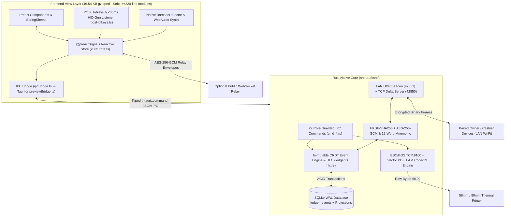
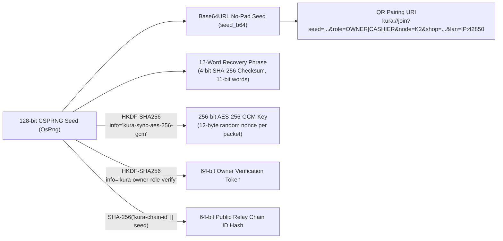

<div align="center">


# Kura (蔵) — Offline Shop Stock, POS & Multi-Phone Bill Sync

**Ultra-lightweight, zero-account, offline-first Point-of-Sale, CRDT Inventory Ledger, Customer Khata, Cash Drawer Reconciliation & Thermal/PDF Receipt Engine.**

[](https://v2.tauri.app/)
[](https://www.rust-lang.org/)
[](https://preactjs.com/)
[](https://tailwindcss.com/)
[](https://www.sqlite.org/wal.html)
[](#5-cryptographic-sync-chain--key-hierarchy)
[](#11-developer-setup-testing--build-instructions)

</div>

---

## 1. Brand Vision & Engineering Ethos

In traditional Japanese architecture, a **Kura (蔵)** is an earthen-walled merchant storehouse engineered to safeguard a family business's most valuable goods and accounting ledgers from fire, theft, and disaster.

**Kura** applies that exact philosophy to modern neighborhood commerce across Android phones and Windows counters:
- Your inventory counts, bills, profit margins, and customer due ledgers live inside a fast, ACID-compliant **SQLite WAL** vault on your own devices.
- All business logic, CRDT merging, cryptography, LAN networking, ESC/POS encoding, and vector PDF rendering execute in native **Rust**.
- The user interface is an Apple Cupertino HIG **Preact + Signals + Tailwind CSS v4** layer delivering the entire production frontend in **`46.54 KB` gzipped** (`0.44 KB` HTML + `6.56 KB` CSS + `39.54 KB` JS), strictly enforcing a **220-line per-file ceiling** across every `.rs`, `.ts`, and `.tsx` source file.

---

## 2. Executive Summary: Why Kura Exists

| Capability | Typical Cloud SaaS POS | **Kura (蔵)** |
| :--- | :--- | :--- |
| **Account / Login Required** | Mandatory email, OTP & cloud workspace | **Zero accounts** — instant offline launch |
| **Monthly / Per-Register Cost** | \$15–\$79/month per terminal | **\$0 forever** — zero developer servers |
| **Offline Checkout & Stock** | Breaks or causes lost stock overwrites | **Deterministic CRDT HLC ledger** merges offline edits safely |
| **Multi-Phone Counter Sync** | Requires round-trip cloud servers | **Brave-style QR Sync Chain** over local Wi-Fi + optional E2EE relay |
| **Cashier Permission Safety** | Often exposes wholesale cost & profits | **Cryptographic `OWNER` vs `CASHIER` roles** redact COGS & lock voids |
| **Money Arithmetic** | Floating-point (`0.1 + 0.2`) rounding bugs | **Strict `i64` minor units** across Rust, SQLite & TypeScript |
| **Thermal & PDF Printing** | Heavy PDF rasterizers / proprietary SDKs | **Pure-Rust TCP `9100` ESC/POS + Zero-Dependency PDF 1.4** |
| **Frontend Footprint** | 1.5 MB – 12 MB Electron/React bloat | **`46.54 KB` gzipped** (`dist/` total) |

---

## 3. Complete Feature Breakdown (Milestones 1–4)

### Counter, Checkout & Cashier Speed
- **1-Handed Apple HIG Counter (`CounterView.tsx`)**: Sticky glass search bar, horizontal category pills, live `tabular-nums` stock pills (`green` / `amber` / `red`), instant add/decrement controls, and thumb-reachable checkout dock.
- **Hold / Park Cart Queue (`F6`) (`parkedCarts.ts`, `ParkedCartsBar.tsx`)**: Pause up to **5 simultaneous customer baskets** with automatic swap when resuming a parked cart while another basket is active.
- **Instant Receipt Barcode Lookup**: Scanning or typing any issued bill code (`^K\d+-\d{6}-\d{4}$`, e.g., `K1-261112-0001`) opens `ReceiptSheet.tsx` in under 1 second for verification, reprinting, WhatsApp sharing, or Owner voiding.
- **Zero-KB POS Audio Synthesizer (`posAudio.ts`)**: Web Audio API `OscillatorNode` synthesis produces crisp 1200Hz scan beeps, two-tone Apple Pay-style checkout chimes, and low-frequency warning buzzes with **0 bytes** of external MP3/WAV assets and a header mute toggle.

### Inventory Vault, CSV & Vector Barcode Labels
- **CRDT Inventory Vault (`KuraVaultView.tsx`)**: Add/edit SKUs (Owner-only), perform quick restocks/damage write-offs (`STOCK_ADJUST`), scan barcodes directly into new product forms, and monitor low-stock alerts.
- **Bulk CSV Import & Export (`cmd_catalog_csv.rs`, `CsvCatalogSheet.tsx`)**: Zero-dependency RFC-4180-compatible CSV parser converts decimal currency strings directly into integer minor units with zero floating-point math, committing multi-row imports in a single atomic SQLite transaction.
- **Printable A4 3×8 Vector Code-39 Sticker PDFs (`barcode_pdf.rs`)**: Generates crisp vector barcode sheets (24 labels per A4 page, multi-page pagination) ready for any office inkjet/laser or sticker printer.

### Customer Credit ("Khata" / Due) & Cash Drawer Reconciliation
- **Customer Due / Khata Ledger (`ledger_customers.rs`, `CustomerKhataSheet.tsx`)**: Issue bills under **`Cash`**, **`Wallet / QR`**, or **`Customer Due`**, pick or inline-create a customer during checkout, track shop receivables in the header **`Due`** pill, and settle partial or full balances via `CUSTOMER_PAYMENT` events synced across all devices. Voiding a `DUE` bill atomically reverses the customer's due balance.
- **Daily Cash Drawer & Petty Expense Ledger (`ledger_expenses.rs`, `CashDrawerSheet.tsx`)**: Real-time till reconciliation (`Cash Sales + Khata Cash Collected − Petty Expenses`) with category pills (`Supplies`, `Utility / Rent`, `Tea / Staff`, `Transport`, `Supplier Payout`), backed by immutable `EXPENSE_LOGGED` events.

### Multi-Phone Sync Chain, Owner Analytics & Digital/Thermal Receipts
- **Brave-Style Multi-Phone Sync Chain (`crypto_chain.rs`, `lan_sync.rs`, `remoteRelay.ts`)**: Generate a 128-bit shop seed and pair Owner (`OWNER`) or staff (`CASHIER`) phones via `kura://join?...` QR codes or a checksum-verified **12-word recovery mnemonic**.
- **Dual Transport Sync**: Automatic **LAN UDP Discovery (`42851`) + TCP Delta Streaming (`42850`)** on shop Wi-Fi/Hotspots, plus optional **Zero-Knowledge WebSocket Relay** pushing AES-256-GCM encrypted envelopes for remote owner monitoring.
- **Encrypted `.kura` Vault Snapshots (`cmd_config_vault.rs`)**: Export and restore the entire shop event log as an AES-256-GCM encrypted `.kura` archive verified by your 12-word phrase.
- **Owner-Only Analytics (`ledger_analytics.rs`)**: Real-time Gross Revenue, Estimated COGS, Net Profit, Margin (bps), and Per-Terminal breakdown (`K1`, `K2`, `K3`) — blocked on `CASHIER` devices alongside catalog cost price redaction.
- **Wireless ESC/POS, Vector PDF & 1-Tap WhatsApp Bills**: Print directly to 58mm/80mm TCP port `9100` printers (`escpos.rs`), export compact PDF 1.4 receipts embedded with a scannable Code-39 bill barcode (`pdf_gen.rs`), or send formatted monospace receipts via **WhatsApp (`https://wa.me/...`)** and clipboard copy (`whatsappReceipt.ts`).

---

## 4. System Architecture & Sequence Diagrams

### 4.1 High-Level Hybrid Architecture



### 4.2 CRDT Conflict-Free Offline Multi-Phone Sync Sequence


### 4.3 Cryptographic Sync Chain Key Hierarchy



---

## 5. Mathematical & Data Integrity Guarantees

1. **Integer Minor-Unit Monetary Invariant (`i64`)**:
   - Every monetary amount in Rust (`sell_price_minor`, `cost_price_minor`, `discount_minor`, `total_minor`, `balance_due_minor`, `amount_minor`), SQLite (`INTEGER`), and TypeScript (`number`) is stored exclusively as **signed 64-bit integer minor units** (e.g., `350` = `$3.50`, `14900` = `৳149.00`).
   - Decimal formatting happens strictly at display/print boundaries (`formatMoney` in TypeScript and `format_minor_money` in `printer/mod.rs`). CSV price parsing converts integer and fractional digits manually (`parse_money_to_minor` in `cmd_catalog_csv.rs`) with zero IEEE-754 floating-point conversions.

2. **Hybrid Logical Clock (HLC) Causal Ordering (`hlc.rs`)**:
   - Format: `{ISO8601_ms}-{4DigitCounter}-{NodeID}` (example: `2026-11-12T15:30:05.120Z-0001-K1`).
   - Fixed-width ISO-8601 UTC millisecond timestamps plus 4-digit zero-padded counters make lexicographical SQLite sorting identical to causal partial order. On remote sync, `observe_remote_hlc` advances the local clock past future-skewed peers without regressing causality.

3. **Collision-Free Invoice Numbering (`hlc.rs`)**:
   - Format: `{NodeID}-{YYMMDD}-{4DigitDailySeq}` (example: `K1-261112-0001`, `K2-261112-0001`).
   - Because each device holds a distinct `NodeID` (`K1`, `K2`, `K3`, ...) and queries local daily counts, two offline terminals never issue duplicate receipt numbers.

4. **Expected Physical Cash Drawer Formula (`ledger_expenses.rs`)**:
   $$\text{Expected Physical Cash} = \text{Cash Bills} + \text{Khata Cash Collected} - \text{Petty Expenses}$$
   Implemented with saturating integer arithmetic (`cash_sales_minor.saturating_add(khata_cash_collected_minor).saturating_sub(total_expenses_minor)`), where `Wallet / QR` and `Customer Due` sales are tracked separately so non-cash tenders never inflate physical till expectations.

5. **Never Overwrite Mutable Stock (`ledger.rs`)**:
   - Stock updates NEVER run `UPDATE products SET stock_qty = ?`. Sales decrement relatively (`stock_qty - qty`), restocks adjust relatively (`stock_qty + delta`), voids restore relatively (`stock_qty + qty`), and every `ledger_event` is guarded by `INSERT OR IGNORE` on `event_id` so replays and duplicate network packets are strictly idempotent.

---

## 6. SQLite Database Schema & Immutable Event Specification

### 6.1 Database Tables (`ledger_init.rs`)

| Table | Columns & Constraints | Purpose |
| :--- | :--- | :--- |
| `chain_config` | `id INTEGER PRIMARY KEY CHECK (id = 1)`, `node_id TEXT`, `shop_name TEXT`, `shop_subtitle TEXT`, `currency_symbol TEXT`, `receipt_footer TEXT`, `role TEXT`, `seed_b64 TEXT`, `last_hlc TEXT`, `is_linked INTEGER` | Device identity, Sync Chain seed, role (`OWNER`/`CASHIER`), and HLC watermark |
| `ledger_events` | `event_id TEXT PRIMARY KEY`, `hlc TEXT`, `node_id TEXT`, `event_type TEXT`, `payload_json TEXT`, `synced_lan INTEGER`, `synced_relay INTEGER` (+ `idx_ledger_hlc`) | Append-only CRDT source of truth replicated across peers |
| `products` | `sku TEXT PRIMARY KEY`, `name TEXT`, `barcode TEXT`, `category TEXT`, `sell_price_minor INTEGER`, `cost_price_minor INTEGER`, `stock_qty INTEGER`, `low_stock_threshold INTEGER`, `updated_hlc TEXT` | Materialized catalog & live inventory projection |
| `bills` | `bill_no TEXT PRIMARY KEY`, `node_id TEXT`, `hlc TEXT`, `items_json TEXT`, `discount_minor INTEGER`, `total_minor INTEGER`, `payment_mode TEXT`, `customer_id TEXT`, `voided INTEGER` | Materialized receipts (`CASH`, `WALLET`, `DUE`) & void flags |
| `customers` | `customer_id TEXT PRIMARY KEY`, `name TEXT`, `phone TEXT`, `balance_due_minor INTEGER`, `updated_hlc TEXT` | Materialized Customer Due ("Khata") balances |
| `expenses` | `expense_id TEXT PRIMARY KEY`, `category TEXT`, `amount_minor INTEGER`, `note TEXT`, `node_id TEXT`, `hlc TEXT` | Materialized petty cash expenses deducted from till |

### 6.2 Immutable `LedgerEvent` Types & JSON Payloads

1. **`PRODUCT_UPSERT`** — Last-write-wins catalog metadata by `updated_hlc <= excluded.updated_hlc` (preserves live `stock_qty`):
   ```json
   {
     "sku": "SKU-101",
     "name": "Artisan Cold Brew 250ml",
     "barcode": "890101001010",
     "category": "Beverages",
     "sell_price_minor": 350,
     "cost_price_minor": 180,
     "low_stock_threshold": 6
   }
   ```
2. **`STOCK_ADJUST`** — Commutative inventory delta (restock, shrinkage, initial count):
   ```json
   { "sku": "SKU-101", "delta": 24, "reason": "Restock delivery" }
   ```
3. **`BILL_ISSUED`** — Atomic sale deduction + optional `DUE` customer balance increment:
   ```json
   {
     "bill_no": "K1-261112-0001",
     "node_id": "K1",
     "hlc": "2026-11-12T10:00:00.000Z-0004-K1",
     "items": [
       { "sku": "SKU-101", "name": "Artisan Cold Brew 250ml", "qty": 2, "unit_price_minor": 350, "line_total_minor": 700 }
     ],
     "discount_minor": 0,
     "total_minor": 700,
     "payment_mode": "DUE",
     "customer_id": "K1-C001",
     "voided": false
   }
   ```
4. **`BILL_VOIDED`** — Marks bill voided once, restores line-item stock, and reverses `balance_due_minor` if `payment_mode == "DUE"`:
   ```json
   { "bill_no": "K1-261112-0001" }
   ```
5. **`SHOP_SETTINGS_UPDATED`** — Broadcasts shop branding, currency symbol, and thermal receipt footer across synced phones:
   ```json
   {
     "shop_name": "Kura General Store",
     "shop_subtitle": "Local Retail · Offline POS",
     "currency_symbol": "$",
     "receipt_footer": "Thank you for shopping!"
   }
   ```
6. **`CUSTOMER_UPSERT`** — Creates or updates customer profile while keeping existing `balance_due_minor` intact:
   ```json
   { "customer_id": "K1-C001", "name": "Rahim Traders", "phone": "01711-000111" }
   ```
7. **`CUSTOMER_PAYMENT`** — Decrements customer receivable balance and adds to cash drawer Khata collections:
   ```json
   {
     "payment_id": "PAY-ev-2026...",
     "customer_id": "K1-C001",
     "amount_minor": 500,
     "note": "Cash settlement"
   }
   ```
8. **`EXPENSE_LOGGED`** — Records shop petty cash outflow across all Sync Chain devices:
   ```json
   {
     "expense_id": "EXP-ev-2026...",
     "category": "Supplies",
     "amount_minor": 250,
     "note": "Paper roll & cups",
     "node_id": "K1",
     "hlc": "2026-11-12T10:15:00.000Z-0009-K1"
   }
   ```

---

## 7. Complete Tauri IPC Command Reference (27 Commands)

| Command | Rust Module | Parameters | Returns | Role Guard |
| :--- | :--- | :--- | :--- | :--- |
| `get_bootstrap_state` | `cmd_catalog.rs` | `—` | `BootstrapState` | All (redacts `cost_price_minor` to `0` for `CASHIER`) |
| `upsert_product` | `cmd_catalog.rs` | `input: UpsertProductInput` | `Product` | **`OWNER` only** |
| `adjust_stock` | `cmd_catalog.rs` | `sku: String, delta: i64, reason: String` | `Product` | All |
| `issue_bill` | `cmd_billing.rs` | `input: IssueBillInput` | `BillReceipt` | All |
| `void_bill` | `cmd_billing.rs` | `bill_no: String` | `BillReceipt` | **`OWNER` only** |
| `get_recent_bills` | `cmd_billing.rs` | `—` | `Vec<BillReceipt>` | All |
| `find_bill_by_no` | `cmd_billing.rs` | `bill_no: String` | `Option<BillReceipt>` | All |
| `get_sync_status` | `cmd_sync_print.rs` | `—` | `SyncChainStatus` | All (`recovery_phrase` returned for backup) |
| `join_sync_chain` | `cmd_sync_print.rs` | `input: String, role_override: Option<String>` | `SyncChainStatus` | All |
| `trigger_peer_sync` | `cmd_sync_print.rs` | `peer_ip: Option<String>` | `String` | All |
| `print_bill_thermal` | `cmd_sync_print.rs` | `ip: String, port: u16, width_mm: u16, bill_no: String` | `String` | All |
| `export_bill_pdf` | `cmd_sync_print.rs` | `bill_no: String` | `PdfExportResult` | All |
| `prepare_relay_envelope` | `cmd_sync_print.rs` | `since_hlc: String` | `RelayEnvelope` | All (AES-256-GCM encrypted) |
| `ingest_relay_envelope` | `cmd_sync_print.rs` | `cipher_b64: String` | `usize` | All |
| `get_shop_settings` | `cmd_config_vault.rs` | `—` | `ShopSettings` | All |
| `update_shop_settings` | `cmd_config_vault.rs` | `input: ShopSettingsInput` | `ShopSettings` | **`OWNER` only** |
| `get_owner_analytics` | `cmd_config_vault.rs` | `—` | `OwnerAnalytics` | **`OWNER` only** |
| `export_encrypted_vault` | `cmd_config_vault.rs` | `—` | `VaultExportResult` | **`OWNER` only** |
| `import_encrypted_vault` | `cmd_config_vault.rs` | `payload_b64: String, recovery_phrase: Option<String>` | `usize` | **`OWNER` only** |
| `get_customers` | `cmd_customers.rs` | `—` | `Vec<CustomerAccount>` | All |
| `upsert_customer` | `cmd_customers.rs` | `customer_id: Option<String>, name: String, phone: String` | `CustomerAccount` | All |
| `record_customer_payment` | `cmd_customers.rs` | `customer_id: String, amount_minor: i64, note: String` | `CustomerAccount` | All |
| `export_barcode_labels_pdf` | `cmd_catalog_csv.rs` | `skus: Vec<String>, copies_per_sku: u32` | `PdfExportResult` | All |
| `export_catalog_csv` | `cmd_catalog_csv.rs` | `—` | `String` | All (redacts cost for `CASHIER`) |
| `import_catalog_csv` | `cmd_catalog_csv.rs` | `csv_content: String` | `u32` | **`OWNER` only** |
| `log_shop_expense` | `cmd_expenses.rs` | `category: String, amount_minor: i64, note: String` | `ShopExpense` | All |
| `get_cash_drawer_summary` | `cmd_expenses.rs` | `—` | `CashDrawerSummary` | All |

---

## 8. Repository File Tree & Modular Architecture

Every source file under `src/` and `src-tauri/src/` is strictly capped at **<= 220 lines** so modules remain cohesive and easy to audit.

```text
Kura - Shop Stock & Bill Sync/
├── .agents/
│   ├── rules/kura-architecture.md          # Global architectural & HIG invariants
│   └── skills/                             # Domain skills (Rust core, CRDT ledger, Sync Chain, ESC/POS, Audio, HIG UI)
├── docs/
│   ├── PLAY_STORE_LISTING.md               # ASO store copy, screenshot prompts & Android release build steps
│   └── PRIVACY_POLICY.md                   # Google Play Console offline-first privacy disclosure
├── public/
│   └── kura-icon.svg                       # Apple squircle Kura (蔵) storehouse brand SVG
├── src/
│   ├── main.tsx & App.tsx                  # Entry point, header pills (Due, Till, Sound, Hotkeys) & SpringSheet mounts
│   ├── index.css                           # Tailwind CSS v4 styles & scanner line animation
│   ├── types/kura.ts                       # Shared TypeScript interfaces mirroring Rust models
│   ├── state/
│   │   ├── ipcBridge.ts                    # Auto-detects Tauri IPC vs browser preview fallback + integer money format/parse
│   │   ├── kuraStore.ts                    # Core reactive Signals state (cart, products, bills, checkout, thermal/PDF)
│   │   ├── parkedCarts.ts                  # Hold/Park Cart queue (max 5 in localStorage) & bill-number scan lookup
│   │   ├── customerActions.ts              # Khata customer signals & payment actions
│   │   ├── expenseActions.ts               # Cash drawer summary & petty expense actions
│   │   ├── catalogCsvActions.ts            # CSV import/export & A4 barcode label PDF actions
│   │   ├── vaultConfigActions.ts           # Owner analytics, shop settings & .kura vault backup actions
│   │   ├── remoteRelay.ts                  # Optional E2EE WebSocket relay client
│   │   ├── uiSignals.ts                    # Sheet visibility & scanner mode signals
│   │   └── previewBridge.ts & previewFixtures.ts  # Browser preview simulator when running without Tauri runtime
│   └── ui/
│       ├── primitives/ (SegmentedControl.tsx, SpringSheet.tsx)
│       ├── components/ (CheckoutPanel.tsx, DueCustomerPicker.tsx, ParkedCartsBar.tsx, OwnerAnalyticsCard.tsx, PrinterHubCard.tsx, QrPairingCard.tsx, VaultBackupCard.tsx)
│       ├── sheets/     (CashDrawerSheet.tsx, CsvCatalogSheet.tsx, CustomerKhataSheet.tsx, ProductFormSheet.tsx, ReceiptSheet.tsx, ScannerSheet.tsx, ShopSettingsSheet.tsx)
│       ├── utils/      (posAudio.ts, posHotkeys.ts, whatsappReceipt.ts)
│       └── views/      (CounterView.tsx, KuraVaultView.tsx, BillsHistoryView.tsx, SyncAndPrintView.tsx)
└── src-tauri/
    ├── .cargo/config.toml                  # Sets incremental = false for clean Windows builds across drives
    ├── Cargo.toml & tauri.conf.json        # Size-optimized Rust profile (opt-level="z", LTO, strip) & bundle config
    └── src/
        ├── main.rs & lib.rs                # Tauri v2 builder, DB/LAN initialization & 27-command registry
        ├── models.rs & commands.rs         # Shared structs & AppState mutex/LAN state
        ├── hlc.rs                          # Hybrid Logical Clock, ISO-8601 civil dates & daily invoice generator
        ├── crypto_chain.rs & mnemonic.rs   # HKDF-SHA256, AES-256-GCM packets, kura:// URI parser & 12-word recovery
        ├── ledger_init.rs & ledger.rs      # SQLite WAL schema initialization & idempotent CRDT event projection
        ├── ledger_queries.rs               # Chain config, product & receipt queries
        ├── ledger_analytics.rs             # Owner-only gross revenue, COGS, net profit & per-node breakdown
        ├── ledger_customers.rs             # Customer Khata upsert, payment & due balance projections
        ├── ledger_expenses.rs              # Petty expense projection & CashDrawerSummary calculator
        ├── lan_sync.rs & lan_peer.rs       # UDP broadcast discovery (42851) & TCP delta sync server/client (42850)
        ├── cmd_*.rs                        # Focused IPC modules (billing, catalog, catalog_csv, config_vault, customers, expenses, sync_print)
        ├── printer/
        │   ├── mod.rs                      # ASCII currency fallback & integer minor-unit formatter
        │   ├── escpos.rs                   # Raw ESC/POS TCP:9100 encoder (58mm/80mm + partial cut)
        │   ├── pdf_gen.rs                  # Zero-dependency PDF 1.4 vector receipt + bottom Code-39 bill barcode
        │   └── barcode_pdf.rs              # Reusable Code-39 vector encoder + A4 3x8 multi-page sticker sheet PDF
        └── tests.rs                        # Unit tests for HLC drift, CRDT replay, Khata/till math & AES-256-GCM
```

---

## 9. Printing & Hardware Integration Deep-Dive

- **Raw ESC/POS Thermal Stream (`printer/escpos.rs`)**:
  - Sends `0x1B 0x40` (ESC `@` initialize), center/bold/double-size store header, 32-column (**58mm**) or 48-column (**80mm**) fixed-width tables, cash/wallet/due payment info, and `0x1D 0x56 0x42 0x00` partial paper cut over a non-blocking Tokio `TcpStream` to `<printer_ip>:9100`.
  - Automatically transliterates non-ASCII currency symbols in `printer/mod.rs` (`৳ -> Tk `, `€ -> EUR `, `₹ -> Rs.`, `¥ -> JPY `) so budget thermal printers never print garbled glyphs.
- **Zero-Dependency Vector PDF 1.4 & Code-39 (`printer/pdf_gen.rs`, `printer/barcode_pdf.rs`)**:
  - Builds uncompressed, universally readable PDF 1.4 streams (`Courier` & `Courier-Bold` base fonts + vector rectangles `re f`) directly in Rust with zero external PDF crates.
  - Every exported receipt PDF embeds a centered Code-39 vector barcode encoding `bill.bill_no` (`SCAN: K1-261112-0001`) at the bottom, enabling instant physical return verification.
  - Printable **A4 Barcode Sticker Sheets** paginate 24 labels per page (`3 columns × 8 rows`) with shop header, item title, vector Code-39 bars, SKU/barcode text, and formatted retail price.
- **Camera & Hardware Barcode Scanner (`ScannerSheet.tsx`, `posHotkeys.ts`)**:
  - Camera mode uses the platform's native `BarcodeDetector` API across `ean_13`, `ean_8`, `upc_a`, `upc_e`, `code_128`, `code_39`, and `qr_code`.
  - Hardware USB/Bluetooth HID barcode scanners (keyboard-emulation guns) are detected automatically anywhere in the app by capturing rapid keystroke bursts (`<= 35ms` inter-key gap) terminated by `Enter`, adding items to cart or opening matching receipts immediately without stealing focus from search.

---

## 10. Keyboard Shortcuts & Cashier Ergonomics

| Key / Trigger | Action | Behavior Notes |
| :--- | :--- | :--- |
| **`/`** or **`Ctrl + K`** | Focus Counter Search | Switches to Counter tab and focuses `#kura-counter-search` |
| **`F2`** | Toggle Camera Scanner | Opens or closes the live `BarcodeDetector` / QR pairing sheet |
| **`F4`** | Instant Charge & Print | Issues bill immediately when cart has >= 1 item |
| **`F6`** | Hold / Park Current Cart | Parks current cart into the 5-slot hold queue and clears counter |
| **`Escape`** | Dismiss Active Sheet | Closes scanner, receipt, product, settings, Khata, till, or CSV sheet |
| **HID Scan + `Enter`** | Barcode Gun Auto-Action | Matches `^K\d+-\d{6}-\d{4}$` -> opens `ReceiptSheet`; otherwise increments product SKU/barcode in cart |

---

## 11. Developer Setup, Testing & Build Instructions

### Prerequisites
- **Node.js** `>= 20` & `npm`
- **Rust** stable toolchain (`cargo`, `rustc`) + Tauri v2 system dependencies

### Installation & Development
```bash
# Install frontend dependencies
npm install

# Run full native Desktop Tauri app (Rust core + SQLite + LAN sync + Preact UI)
npm run tauri dev

# Or run fast browser-only preview (backed by src/state/previewBridge.ts)
npm run dev
```

### Verification, Unit Tests & Production Builds
```bash
# 1. TypeScript typecheck & production Vite bundle (must remain < 50 KB gzipped)
npm run build

# 2. Rust unit tests (HLC drift, CRDT replay, Khata & drawer math, AES-256-GCM + mnemonic)
cd src-tauri && cargo test

# 3. Rust static check
cd src-tauri && cargo check

# 4. Build native Windows installer (.exe / .msi)
npm run tauri build

# 5. Build Android APK / Play Store AAB (see docs/PLAY_STORE_LISTING.md)
npx tauri android init
npx tauri android build --aab --apk
```

> **Note for Windows workspace paths containing `&`**: `package.json` invokes `node ./node_modules/...` directly for `dev`, `build`, `preview`, and `tauri` scripts so Windows `cmd.exe` `.cmd` shims work seamlessly inside folders containing special characters.

---

## 12. Security, Privacy & License

- **Cryptography**: Every LAN frame, `.kura` vault backup, and optional WebSocket relay envelope is encrypted client-side with **AES-256-GCM** using keys derived via **HKDF-SHA256** from your device's 128-bit Sync Chain seed and random 96-bit nonces.
- **Privacy Compliance**: Zero telemetry, zero analytics SDKs, and zero remote accounts. Read the full Play Console policy in [docs/PRIVACY_POLICY.md](docs/PRIVACY_POLICY.md) and store release guide in [docs/PLAY_STORE_LISTING.md](docs/PLAY_STORE_LISTING.md).
- **License**: Proprietary / Shop Source-Available (see repository root configuration for distribution terms).
